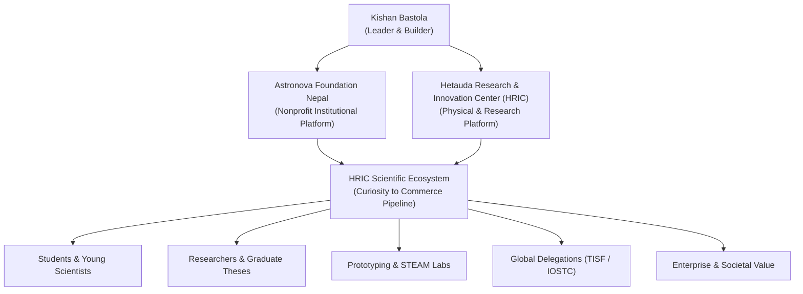

# CONTEXT.md
### Single Source of Truth — Kishan Bastola Professional Portfolio
#### Based on: Developer Handoff & Website Content Brief (`Kishan_Bastola_Portfolio_Website_Developer_Brief.docx`)

This document is the authoritative project context for the personal professional portfolio of **Kishan Bastola**. All development, UX architecture (`UX.md`), and data modeling (`DATA.md`) must treat this document as the factual baseline and ground truth. Where this file is silent, do not invent facts, metrics, or achievements; mark content as pending verification per the strict Content Accuracy Rules below.

---

## 1. Project Overview (परियोजनाको उद्देश्य)

यो वेबसाइट Kishan Bastola को व्यक्तिगत Professional Portfolio हो। यसको उद्देश्य साधारण CV वा संस्थाको वेबसाइट बनाउनु होइन; व्यक्तिको शैक्षिक पृष्ठभूमि, नेतृत्व, विचार, संस्थागत पहल, कामको प्रभाव, भविष्यको दृष्टि र सहकार्यका सम्भावना प्रश्नमा आधारित सरल र आकर्षक अनुभवमार्फत प्रस्तुत गर्नु हो।

The website is a high-signal, executive-grade personal portfolio designed to communicate Kishan Bastola's life work, educational philosophy, institutional leadership, and future vision through an engaging, question-driven narrative rather than an exhaustive or crowded CV.

Every visitor must be able to quickly answer these six foundational questions:
1. **Who is Kishan Bastola and what is his professional background?** (Kishan Bastola को हुन् र उनको professional background के हो?)
2. **What does he believe in and what problems is he solving?** (उनले के विश्वास गर्छन् र कुन समस्या समाधान गर्न खोजिरहेका छन्?)
3. **What institutions, programs, and ecosystem is he building?** (उनले कुन संस्था, कार्यक्रम र ecosystem निर्माण गरिरहेका छन्?)
4. **What is the evidence, milestone achievement, and impact of his work?** (उनको कामको प्रमाण, उपलब्धि र प्रभाव के हो?)
5. **What does his signature concept "From Curiosity to Commerce" mean?** (उनको मुख्य अवधारणा ‘From Curiosity to Commerce’ को अर्थ के हो?)
6. **How can someone contact or collaborate with him?** (उनीसँग कसरी सम्पर्क वा सहकार्य गर्न सकिन्छ?)

---

## 2. Core Identity & Brand Positioning (मुख्य परिचय र ब्रान्ड पोजिसनिङ)

### Name & Identity
- **Full Name (English):** KISHAN BASTOLA
- **Full Name (Nepali):** किशन बास्तोला (नागरिकता/औपचारिक: नैत्र प्रसाद बास्तोला)
- **Professional Identity:** Educationist | Mathematician | Research & Innovation Ecosystem Builder
- **Core Credentials Summary:** Master’s Degree in Mathematics | 18 Years in Education

### Signature Line & Concept
- **Signature Line:** FROM CURIOSITY TO COMMERCE
- **Concept Tagline:** "Building an ecosystem that transforms curiosity into knowledge, research, innovation, enterprise and value creation."
- **Nepali Tagline:** "जिज्ञासादेखि वाणिज्यसम्म: शिक्षा र जिज्ञासालाई अनुसन्धान, नवप्रवर्तन, उद्यम र मूल्य सिर्जनामा रूपान्तरण गर्ने इकोसिस्टम।"

### Short Homepage Introduction (Authoritative Brief Copy)
> "Kishan Bastola is an educationist, mathematician and research & innovation ecosystem builder with 18 years of experience in education. He holds a Master’s Degree in Mathematics and has served as a School Principal and Campus Chief. He leads initiatives through Astronova Foundation Nepal and Hetauda Research and Innovation Center (HRIC), working to connect education, science, technology, research, innovation and entrepreneurship."

> *नेपाली अनुवाद:* "किशन बास्तोला १८ वर्षको शैक्षिक अनुभव भएका शिक्षासेवी, गणितज्ञ तथा अनुसन्धान र नवप्रवर्तन इकोसिस्टम निर्माता हुन्। गणित विषयमा स्नातकोत्तर गरेका बास्तोला पूर्व विद्यालय प्राचार्य तथा कलेज प्रमुख हुन्। उनी एष्ट्रोनोभा फाउण्डेशन नेपाल र हेटौंडा रिसर्च एण्ड इनोभेसन सेन्टर (HRIC) मार्फत शिक्षा, विज्ञान, प्रविधि, अनुसन्धान, नवप्रवर्तन र उद्यमशीलतालाई जोड्न सक्रिय छन्।"

---

## 3. The 6-Question Conceptual Sitemap (प्रश्नमा आधारित ६ मुख्य पेज)

The primary information architecture is anchored in six narrative questions that guide the visitor through Kishan Bastola's story:

| No. | English Page Title | Nepali Title | Core Focus & Narrative Scope |
|:---:|:---|:---|:---|
| **01** | **WHAT SHAPED ME?** | मेरो पृष्ठभूमि, शिक्षा र यात्राले मलाई कसरी निर्माण गर्यो? | Personal story, Master’s Degree in Mathematics, 18 years in education, former School Principal and Campus Chief, career timeline, key turning points and professional development. |
| **02** | **WHAT DRIVES ME?** | मलाई कुन उद्देश्य, विश्वास र दर्शनले अघि बढाउँछ? | Education philosophy, student-centred learning, curiosity, mathematics and scientific thinking, belief that lack of resources should not prevent student potential, and the purpose behind the work. |
| **03** | **WHAT PROBLEMS AM I SOLVING?** | शिक्षा, अनुसन्धान र नवप्रवर्तन क्षेत्रमा म कुन समस्या समाधान गर्न खोज्दैछु? | Explain the gaps being addressed: limited hands-on learning, weak access to mentors and laboratories, limited student research pathways, and weak links between learning, innovation and real-world application. Present these as problem statements and validate with evidence where possible. |
| **04** | **WHAT AM I CREATING?** | म कुन संस्था, प्रणाली र अवसर निर्माण गर्दैछु? | Astronova Foundation Nepal, Hetauda Research and Innovation Center (HRIC), HRIC Scientific Ecosystem, STEAM learning initiatives, student research and science fair pathways, mentor networks and institutional partnerships. Show the relationship among these initiatives with a clear ecosystem diagram. |
| **05** | **HOW DO I CREATE VALUE?** | म ज्ञान, अनुसन्धान र नवप्रवर्तनलाई वास्तविक मूल्यमा कसरी रूपान्तरण गर्छु? | This page explains the signature framework From Curiosity to Commerce: Curiosity → Learning → Research → Prototype → Innovation → Enterprise → Commerce. Clarify that commerce means real-world application, market relevance and social/economic value—not simply pushing students into business. |
| **06** | **WHAT FUTURE AM I BUILDING?** | म कस्तो भविष्य निर्माण गर्न चाहन्छु र कोसँग सहकार्य गर्न चाहन्छु? | Long-term vision for Nepal, future direction for HRIC and scientific ecosystem development, research interests, desired partnerships with universities, schools, government, researchers, industry and international organizations. Include a clear collaboration/contact invitation. |

*Architectural Implementation Note:* In production, these six thematic inquiries are organized into four cohesive editorial chapters (`Who am I ?` [Q01+Q02], `How does it work ?` [Q03+Q05], `What have we built ?` [Q04], `Shall we collaborate ?` [Q06]) with clean shareable routes (`/who-am-i`, `/how-it-works`, `/what-we-built`, `/collaborate`) and anchors to ensure complete accessibility, zero content loss, and seamless responsive reading.

### Verbatim Site Map Specification (आधिकारिक साइटम्याप)
```
01. WHAT SHAPED ME?
मेरो पृष्ठभूमि, शिक्षा र यात्राले मलाई कसरी निर्माण गर्यो?
Personal story, Master’s Degree in Mathematics, 18 years in education, former School Principal and Campus Chief, career timeline, key turning points and professional development.

02. WHAT DRIVES ME?
मलाई कुन उद्देश्य, विश्वास र दर्शनले अघि बढाउँछ?
Education philosophy, student-centred learning, curiosity, mathematics and scientific thinking, belief that lack of resources should not prevent student potential, and the purpose behind the work.

03. WHAT PROBLEMS AM I SOLVING?
शिक्षा, अनुसन्धान र नवप्रवर्तन क्षेत्रमा म कुन समस्या समाधान गर्न खोज्दैछु?
Explain the gaps being addressed: limited hands-on learning, weak access to mentors and laboratories, limited student research pathways, and weak links between learning, innovation and real-world application. Present these as problem statements and validate with evidence where possible.

04. WHAT AM I CREATING?
म कुन संस्था, प्रणाली र अवसर निर्माण गर्दैछु?
Astronova Foundation Nepal, Hetauda Research and Innovation Center (HRIC), HRIC Scientific Ecosystem, STEAM learning initiatives, student research and science fair pathways, mentor networks and institutional partnerships. Show the relationship among these initiatives with a clear ecosystem diagram.

05. HOW DO I CREATE VALUE?
म ज्ञान, अनुसन्धान र नवप्रवर्तनलाई वास्तविक मूल्यमा कसरी रूपान्तरण गर्छु?
This page explains the signature framework From Curiosity to Commerce: Curiosity → Learning → Research → Prototype → Innovation → Enterprise → Commerce. Clarify that commerce means real-world application, market relevance and social/economic value—not simply pushing students into business.

06. WHAT FUTURE AM I BUILDING?
म कस्तो भविष्य निर्माण गर्न चाहन्छु र कोसँग सहकार्य गर्न चाहन्छु?
Long-term vision for Nepal, future direction for HRIC and scientific ecosystem development, research interests, desired partnerships with universities, schools, government, researchers, industry and international organizations. Include a clear collaboration/contact invitation.
```

---

## 4. Professional Roles & Verified Credentials

All roles displayed on the portfolio must adhere to confirmed evidence:

1. **Academic Degree:** Master’s Degree in Mathematics (Tribhuvan University).
2. **Sector Tenure:** 18 Years in the education sector (Secondary & Higher Education).
3. **Leadership Experience:**
   - Former School Principal
   - Former Campus Chief (Narayani College)
4. **Current Institutional Designations:**
   - **President** — Astronova Foundation Nepal (Nonprofit educational & scientific foundation)
   - **Founder & Director** — Hetauda Research and Innovation Center (HRIC)
   - **Country Leader** — Taiwan International Science Fair (TISF)
   - **Province Secretary** — Mathematical Association of Nepal (MAN), Bagmati Province
   - **Executive Member** — Nepal Mathematical Society (NMS), Bagmati Province

---

## 5. Institutional & Ecosystem Relationships (संस्था तथा Ecosystem सम्बन्ध)

The website must clearly elucidate the distinction and synergy between the organizations Kishan leads:



### Institutional Entities:
1. **Astronova Foundation Nepal:**
   - A non-profit institutional platform providing organizational governance, vision, and nationwide outreach.
   - Core focus: cultivating creative, scientific, and entrepreneurial mindsets in youth.
2. **Hetauda Research and Innovation Center (HRIC):**
   - A community-anchored research, innovation, technology, and learning hub in Hetauda, Bagmati Province.
   - Operates as a collaborative platform connecting students, educators, academic researchers, and industry.
3. **Programs & Initiatives Status Categorization:**
   - Every program must explicitly indicate its maturity level:
     - `Active` (हाल सञ्चालनमा): Young Scientist Development Program (YSDP), STEAM Workshops, TISF delegations.
     - `Pilot` (परीक्षण चरण): Regional Innovation Incubation, Graduate Thesis Mentorship.
     - `Planned` (आगामी योजना): National Science & Engineering Fair (NSEF) expansion, Maker Space commercialization hub.

---

## 6. The Signature Framework: From Curiosity to Commerce

The core intellectual contribution of Kishan Bastola is the 7-stage pathway that bridges raw classroom inquiry with tangible societal and economic value:

$$\text{Curiosity} \longrightarrow \text{Learning} \longrightarrow \text{Research} \longrightarrow \text{Prototype} \longrightarrow \text{Innovation} \longrightarrow \text{Enterprise} \longrightarrow \text{Commerce}$$

### Stage Definitions:
1. **Curiosity (जिज्ञासा):** The unprompted, authentic question asked by a student when observing a natural phenomenon or community challenge.
2. **Learning (सिकाइ):** Disciplined inquiry, foundational mathematics, literature review, and mentorship that contextualizes the question.
3. **Research (अनुसन्धान):** Structured scientific methodology, data collection, mathematical modeling, and hypothesis testing.
4. **Prototype (प्रोटोटाइप):** Building a tangible, working proof-of-concept in the laboratory or workshop.
5. **Innovation (नवप्रवर्तन):** Refining the prototype into an efficient, repeatable solution that solves a real-world problem.
6. **Enterprise (उद्यम):** Establishing organizational, legal, and operational structures around the innovation.
7. **Commerce (वाणिज्य):** Delivering market relevance, economic sustainability, and measurable public value—*not merely commercialization, but social value creation*.

---

## 7. Design Direction & User Experience (Section 7 of Brief)

- **Tone & Aesthetic:** Mature, academic, thoughtful, minimalist, and internationally credible. Zero SaaS clichés, zero neon colors, zero fake AI animations.
- **Strict Light Mode:** Clean matte ivory (`#FAFAF7`), pure white cards (`#FFFFFF`), slate cream alt backgrounds (`#F3F1EB`), and deep charcoal editorial typography (`#181B1E`).
- **Color Palette:**
  - Primary Base: `#FAFAF7` (Ivory Canvas)
  - Surface: `#FFFFFF` (Crisp Matte White)
  - Text Primary: `#181B1E` (Deep Editorial Charcoal)
  - Text Secondary: `#4A4E56` (Slate Grey)
  - Accent Navy: `#0F2C4A` (Deep Academic Navy Blue)
  - Accent Gold: `#9A8055` (Matte Bronze Gold)
- **Typography:** Exactly two classical typefaces:
  - Serif: *Fraunces* (Editorial headlines, quotes, identity titles)
  - Sans: *Inter* (UI navigation, body copy, technical data, metrics)
- **Visual Evidence:** Prioritize authentic, verified photography of Kishan, students, labs, science fairs, and workshops (`/images/hero.png`, `/images/gallery/`, `/images/delegations/`). Never use generic AI or stock photography.
- **Responsive Architecture:** Mobile-first layout with smooth navigation drawer for viewports $\le 860\text{px}$, and pure horizontal navigation on desktop viewports.

---

## 8. Content & Evidence Standards (Section 9 of Brief)

1. **Zero Fabrication:** Never invent awards, publications, student counts, funding amounts, or corporate partnerships.
2. **Maturity Labeling:** Always distinguish between completed milestones, active programs, pilot initiatives, and future visions.
3. **Evidence Backing:** Every flagship project card must be backed by authentic press clippings, verified organizational registration, or event documentation.
4. **Student Privacy & Consent:** Identifiable student photographs must respect academic safeguarding protocols.
5. **Verification Flags:** Any unconfirmed data field in `DATA.md` must carry `verified: false`.

---

## 9. Language Support & Bilingual Parity

- **Languages Supported:** English (`en`) and Nepali (`ne`).
- **Default:** English (`en`), with instant, persistent switching to Nepali (`ne`).
- **Scope of Localization:** Header navigation, page titles, section eyebrows, body narratives, timelines, statistics, buttons, modals, and footer links.
- **Data Architecture:** Translations are maintained as first-class structured objects (`{ en: string; ne: string }`) to prevent machine translation errors and ensure authentic cultural resonance.

---

## 10. Developer Notes & Open Verification Items (Section 14 of Brief)

The following items should be continually cross-referenced with Kishan Bastola for formal public disclosure:
- Confirm exact dates and tenure for Narayani College Campus Chief and School Principal roles.
- Confirm exact annual scopes for Taiwan International Science Fair (TISF) country delegations.
- Maintain up-to-date program statuses (`active`, `pilot`, `planned`) as HRIC expands its facilities.
- Ensure all donation and support information routes strictly through the registered non-profit account (Astronova Foundation Nepal, Rastriya Banijya Bank).
